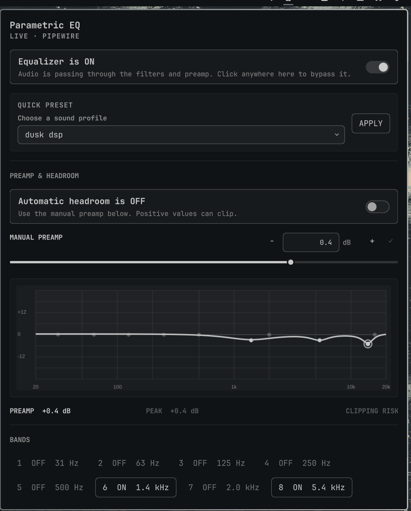

# Parametric EQ for Omarchy

A full parametric PipeWire equalizer for the Omarchy Quattro bar. It combines
ten editable bands, seven filter shapes, a live response graph, real preamp
control, automatic headroom protection, presets, A/B snapshots, undo, and
AutoEQ import in one native Quickshell panel.



## Features

- Ten fully parametric bands, expandable to sixteen through AutoEQ import
- Bell, low/high shelf, low/high pass, notch, and band-pass filters
- Exact frequency, gain, and Q entry with auto-save and fine-step controls
- Per-band and master bypass with unambiguous processing state
- Live logarithmic response graph and estimated clipping/headroom warning
- Functional -30 to +12 dB preamp plus automatic headroom compensation
- Built-in and user presets, undo history, and A/B comparison snapshots
- Local import of standard AutoEQ `ParametricEQ.txt` files
- Live numeric updates without restarting the audio graph

## Requirements

This plugin targets Omarchy 4 (Quattro) and its Quickshell-based shell. It uses
software already included with a stock Omarchy audio setup:

- PipeWire and WirePlumber with the built-in filter-chain module
- `pw-cli`, `pw-dump`, and `pw-metadata`
- Python 3
- `systemctl --user`

No separate DSP package, elevated access, remote service, or account is
required.

## Install

```sh
omarchy plugin add https://github.com/prudhviy99/omarchy-parametric-eq.git --enable
```

Click the equalizer icon, then turn the master equalizer on. First activation
creates the user-owned PipeWire graph and may briefly interrupt audio while
WirePlumber restarts. Frequency, gain, Q, preamp, and bypass changes apply live;
changing a filter shape or band topology may require another short restart.

The Omarchy installer only clones and enables the repository. It does not run
an install hook or request elevated privileges. When the widget is disabled or
removed, its unload guard confirms that the plugin is absent from `shell.json`,
bypasses the EQ, removes the managed audio graph, and restarts WirePlumber.
Ordinary shell restarts and plugin hot reloads leave the graph intact.

## Controls

- Click the bar icon to open the panel; middle-click toggles master processing.
- The master and per-band switches explicitly show `ON`, `OFF`, or `BYPASSED`.
- Drag a slider, use `−/+`, or type an exact value.
- Typed values auto-save after a short pause. Enter or `✓` applies immediately,
  and selecting another band commits the current edit first.
- Click a point in the response graph or a numbered band chip to select it.
- Automatic headroom reduces the effective preamp when the modeled response
  would exceed 0 dB.

## AutoEQ import

Enter the local path to a standard AutoEQ `ParametricEQ.txt` file in the panel.
The importer accepts `Preamp:` and `Filter N: ON PK Fc ... Gain ... Q ...`
records, reads at most 1 MB, and supports up to sixteen filters. The file is
never uploaded.

## Files and permissions

Plugins run unsandboxed inside `omarchy-shell`. This plugin has no network code
and only invokes fixed local commands for PipeWire and the WirePlumber user
service. It creates or updates these user-owned paths:

| Path | Purpose |
| --- | --- |
| `~/.config/omarchy/plugins/io.github.prudhviy99.parametric-eq/` | Plugin checkout |
| `~/.config/omarchy/parametric-eq/` | EQ state, presets, snapshots, and history |
| `~/.config/wireplumber/wireplumber.conf.d/60-omarchy-parametric-eq.conf` | Generated filter graph |

The generated WirePlumber fragment is dedicated to this plugin. The controller
uses `systemctl --user restart wireplumber.service` only when the graph must be
created, removed, or structurally rebuilt. It refuses to replace a symlink,
non-regular file, or fragment without the plugin ownership marker, and restores
the previous managed fragment if a graph rebuild fails.

The state directory is restricted to the current user. State reads are
size-bounded, reject symlinks, hard links, and non-regular files, and remain
attached to the opened file descriptor if a pathname changes. State writes use
atomic descriptor-relative replacement. Output from PipeWire and systemd tools
is also read incrementally under a fixed memory limit.

## Command line

The panel uses `backend/peqctl.py`, which can also be called directly from the
installed plugin directory:

```sh
backend/peqctl.py status
backend/peqctl.py enable
backend/peqctl.py set-band 3 true bell 120 3.5 1.2
backend/peqctl.py set-auto-preamp true
backend/peqctl.py import-autoeq ~/Downloads/ParametricEQ.txt --name "My headphones"
backend/peqctl.py snapshot save A
backend/peqctl.py snapshot apply A
```

## Update

```sh
omarchy plugin update io.github.prudhviy99.parametric-eq
```

## Remove

The standard Omarchy command safely disables the EQ, removes its generated
audio graph and plugin checkout, and retains presets and state:

```sh
omarchy plugin remove io.github.prudhviy99.parametric-eq
```

To remove presets and state as well, run the bundled uninstaller while the
checkout still exists. The checkout and optional state are moved to the desktop
trash:

```sh
plugin_dir="$HOME/.config/omarchy/plugins/io.github.prudhviy99.parametric-eq"
"$plugin_dir/scripts/uninstall.sh" --purge
```

The backend also exposes `cleanup` for recovery. It verifies fragment ownership,
bypasses processing, removes the graph, and leaves presets intact.

## Development and tests

```sh
./tests/run.sh
./tests/integration.sh  # Temporarily exercises the real PipeWire graph
./scripts/install.sh    # Local development install
./scripts/install.sh --force
```

The isolated suite covers state validation, filter coefficients, response and
headroom modeling, import safety, live-control behavior, manifest validation,
fragment ownership and rollback, unload cleanup, QML linting, and manual-entry
focus regressions. The integration test backs up and restores the previous EQ
state and generated fragment.

## License

[MIT](LICENSE) © 2026 Prudhvi Yalamanchili
